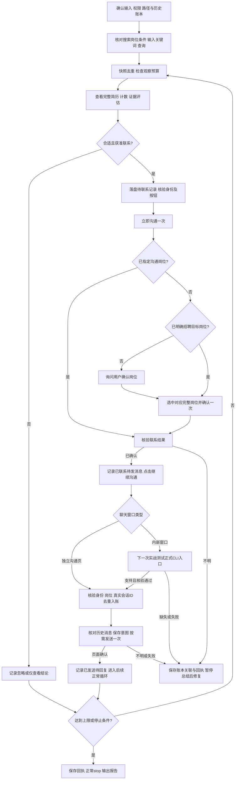

# 搜索 SOP

前置读取：[共用规则](common-rules.md)、[账本与恢复](ledger-and-recovery.md)、[路径核验](paths.md)。真实页面仅使用公开 boss-cli，遵守[工具边界](tool-boundary.md)。以下 `boss` 是简写，执行时在核验后的 cliDir 使用 `node .\dist\cli\index.js`；搜索触达步骤需要包含 `fc55e17` 功能的 CLI；入口元数据中的旧基线不保证这些参数可用，先检查当前安装的 help 与版本来源。

## 输入与权限

从用户已提供的信息确定 JD、评估标准、可选否决项及未知项处理、关键词、观察人数上限 N、触达门槛、目标招聘岗位、获准动作及介绍话术。缺失必需项才询问；不把示例的60分或学校条件作为默认规则。

区分三个概念：搜索关键词、页面搜索岗位条件、最终沟通岗位。关键词不是岗位；“不限职位”不代表最终沟通岗位。用户已指定本轮招聘目标岗位时可据此选岗，无需再次确认。未指定岗位、简称匹配不唯一或页面岗位与用户要求不符时先询问，不自行选择默认项。

用户已授权完整搜索触达流程时按 SOP 连续执行，不逐次索取重复授权；用户要求逐步确认、只读或仅查看时按其边界执行。

## 1. 准备与搜索

1. 保存运行配置、排除名单、历史进度；固定 runDir、ledgerDir 和目标岗位。正式流程启动 collect，严格核对返回账本绝对路径及恢复状态，见路径规范。查看验收也须保存运行记录。
2. 进入 `/web/chat/search`，核对页面实际岗位条件：指定岗位则保留／设置对应岗位；不限岗位则使用页面文案“不限职位”。不要无条件切换为不限职位。当前 CLI 尚未封装搜索栏选岗，由用户设置；不得以联系弹层的 `--select-job` 代替。无特殊工具授权时不自写 DOM 操作。
3. 执行 `boss search "关键词" --json`，核对实际关键词、岗位条件和新结果。当前关键词等待实现仍有已知缺陷，不能只凭命令成功或固定延迟认定查询已生效；无法核对则记录并停止。
4. 保存当前卡片快照并去重。循环内不刷新、不重复查询，不复用旧序号。加载卡片耗尽且仍未到 N 时，才处理明确的加载更多；当前 CLI 无此入口时请用户操作或记录能力缺口后停止，不推断列表已全部耗尽。

## 2. 查看、评估与先行记录

1. 打开下一人前检查观察预算与历史记录。姓名必须完整且唯一匹配；同名、身份不清时停止该人操作，不试点卡片。
2. 使用 `boss preview "姓名" --json` 获取完整截图进行评估；普通 preview 成功后会关闭简历。需要保持简历展开时使用 `--open-only`，但该开关不截图，不可把它的按钮回执当成已读完整简历。若评估后重新打开同一人，不重复计入观察人数，但仍可能消耗平台查看额度。
3. 每成功打开一位不同候选人的在线简历，观察数加1；不合适、证据不足也计数。截图须完整，评分引用证据，未知与置信度单独记录。
4. 不合适只记录本轮忽略，不点平台“不合适”。合适者在触达前保存候选人 ID、来源、目标岗位、评分、准入结果和“待联系”意图。只读／仅查看模式到此为止。
5. 所有记录按[搜索触达记账规则](ledger-and-recovery.md#搜索触达记账)保存。没有会话 dataId 时也必须先落盘待关联记录，不能因暂不能 add 正式账本而漏记。

## 3. 预检与联系

1. 需要在简历内联系时，执行 `boss preview "姓名" --open-only --json`，核验 `identityVerified=true`，保存 `candidateId`。已有同一简历时复用，不关闭后改点底层卡片。
2. 执行 `boss greet "姓名" --check --json`。CLI 通过列表唯一姓名与卡片、简历数据、操作组件中的 ID 一致性核验身份；Canvas 简历不要求存在姓名 DOM。失败不以全局按钮或截图姓名替代身份校验。
3. 在已授权范围内执行一次 `boss greet "姓名" --json`。`already-contacted` 表示不再重复触达，先核对历史；`ready` 只是预检通过，不是联系成功。
4. 按实际岗位条件分支：
   - **已指定沟通岗位**：不走选岗步骤，直接核验联系结果。若仍出现选岗弹层，记录与预期不符，停止核对，不盲目确认。
   - **未指定沟通岗位，即“不限职位”**：首次点击后处理选岗弹层。已有用户指定的招聘目标岗位时，直接唯一匹配完整名称；没有则询问用户。先执行 `boss greet "姓名" --select-job "完整岗位名" --json`，确认 `selected=true`；再执行 `boss greet "姓名" --select-job "完整岗位名" --confirm-contact --json`，只确认一次。选岗本身不等于联系成功。
5. 当前普通 greet 可能在选岗弹层出现后超时报未确认，或因“VVIP账号沟通权益”文字误报为付费弹层。只有核实这是预期的选岗弹层，才进入上述独立步骤；不得重复点击首次入口，不购买权益，不关闭未知弹层。
6. 同一候选人的按钮变为“继续沟通”／CLI 返回 `contactConfirmed=true` 才记录联系成功。否则记录“联系结果待核验”并暂停，不能因超时推断未联系。

## 4. 打开会话、介绍消息与内嵌窗口实战

1. 保存成功回执后执行 `boss greet "姓名" --continue-chat --candidate-id "成功回执中的ID" --json`。联系后卡片可能从搜索列表消失，此入口要求当前简历仍打开，并以回执 ID 核对；不重新按脱敏姓名寻找其他人。
2. `continue-clicked` 仅证明按钮已点击。必须确认实际聊天对象、候选人 ID 关联和沟通岗位；掩码姓名变为完整名不能单凭文字认定为同一人。
3. **独立沟通页 `/web/chat/index`**：以 `boss chat "当前显示姓名" --check --json` 核验当前会话，取得真实 dataId、岗位及消息证据；按账本规范关联入账并记录 PASS。核对已发送内容，完整话术已发送则不重复；仅有其他平台默认问候时才按授权发送介绍消息。
4. **搜索页内嵌聊天窗口**：纳入下一次实战的身份核验与发送支持测试。执行前检查公开 CLI 是否已提供该窗口的正式入口；可用时按“只读核验对象与岗位 → 保存发送意图 → 发送一次 → 核验页面新消息”实测，不要求先另开一轮实战验收。当前已提交版本尚未支持该窗口，不能把本 SOP 当成能力已实现；入口缺失时记录能力缺口，停止发送，随后补齐 CLI 后再验证。不得改用直接 CDP、临时脚本或其他工具绕过。
5. 内嵌窗口测试失败：立即保存阶段、命令、错误、页面可见证据、是否已点击发送、实际 ID／姓名／岗位和待核验事项；先总结问题再修复。不在结果未核实前补发，不删除候选人记录，不返回搜索入口重走联系。
6. 介绍消息正文与换行以用户确认内容为准。发送前记录意图，发送后确认同一会话出现新的己方消息；成功记“已发送待回复”，否则记“发送结果待核验”。没有发送动作的身份核验失败保留“已联系待发消息”。
7. 平台默认问候、介绍消息、附件请求分别记账。消息3不是附件 request=SENT。未回复保持等待，不催促、不标失败；后续目标岗位出现未读再进入收集 SOP。

## 5. 收尾与停止

每人完成后保存回执；正常结束当前人后才关闭对应窗口并核对原搜索条件，不能通过刷新恢复。达到 N、查看额度限制、明确列表耗尽、人工叫停或操作失败时停止；错误时先保存，不继续副作用动作。N 达到后不打开新人，仍可在本轮授权范围内完成当前人的记录与后续步骤。

正常 stop collect，核对 stopped.file、退出与实际落盘。报告观察数、合适数、联系确认数、介绍消息发送确认数、忽略原因、未决记录、正式账本路径及待关联／待同步项。修复后先核对已有结果，从明确未完成步骤恢复，不重放不明动作。

## 流程图

身份预检失败直接进入记录与暂停；图中的每条动作边均受该前提约束。此 SOP 描述流程与测试计划，不声明内嵌窗口发送已验收。
