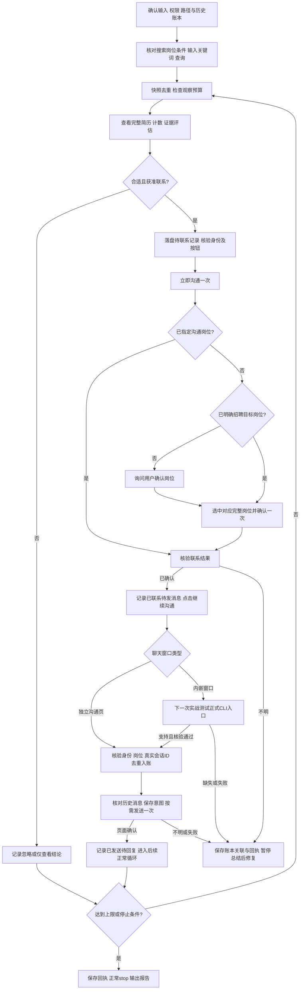

# 搜索 SOP

在线简历截图成功后，立即按[异步 OCR 规范](resume-ocr.md)由 Agent 后台执行公开 `ocr` 命令；等本人的结果完成后优先读文字评估，保留原图核验。不得以异步为由跳过逐人处理、提前评分或触达。

前置读取：[只读check/status规范](check-status.md)、[共用规则](common-rules.md)、[账本与恢复](ledger-and-recovery.md)、[路径核验](paths.md)。真实页面仅使用公开 boss-cli，遵守[工具边界](tool-boundary.md)。以下 `boss` 是简写，执行时在核验后的 cliDir 使用 `node .\dist\cli\index.js`；搜索触达步骤需要包含 `fc55e17` 功能的 CLI；入口元数据中的旧基线不保证这些参数可用，先检查当前安装的 help 与版本来源。

## 输入与权限

从用户已提供的信息确定 JD、评估标准、可选否决项及未知项处理、关键词、观察人数上限 N、触达门槛、目标招聘岗位、获准动作及介绍话术。缺失必需项才询问；不把示例的60分或学校条件作为默认规则。

区分三个概念：搜索关键词、页面搜索岗位条件、最终沟通岗位。关键词不是岗位；“不限职位”不代表最终沟通岗位。用户已指定本轮招聘目标岗位时可据此选岗，无需再次确认。未指定岗位、简称匹配不唯一或页面岗位与用户要求不符时先询问，不自行选择默认项。

用户已授权完整搜索触达流程时按 SOP 连续执行，不逐次索取重复授权；用户要求逐步确认、只读或仅查看时按其边界执行。

仅查看、不联系时不要求触达门槛或话术，不启动正式 collect 写会话，不执行第3、4节。用户同时要求局部错误后继续时，加载[错误分级与继续条件](non-contact-continuation.md)，据此区分停止当前对象与结束本轮；不得放宽身份或截图校验。

## 1. 准备与搜索

1. 保存运行配置、排除名单、历史进度；固定 runDir、ledgerDir 和目标岗位。正式流程启动 collect，严格核对返回账本绝对路径及恢复状态，见路径规范。查看验收也须保存运行记录。
2. 进入 `/web/chat/search`，核对页面实际岗位条件：指定岗位则保留／设置对应岗位；不限岗位则使用页面文案“不限职位”。不要无条件切换为不限职位。当前 CLI 尚未封装搜索栏选岗，由用户设置；不得以联系弹层的 `--select-job` 代替。禁止自写 DOM 操作，不提供临时绕过路径。
3. 执行 `boss search "关键词" --json`，核对实际关键词、岗位条件和新结果。CLI等待本次关键词和当前岗位第1页的查询响应成功，再核对组件及页面列表的候选人ID和查询标识一致。成功空数组才算零结果；响应超时、接口错误、页面未同步均报错，不返回旧列表、不重试。无关键词只读取已加载的当前列表。
4. 保存当前卡片快照并去重。循环内不刷新、不重复查询，不复用旧序号。加载卡片耗尽且仍未到 N、且本轮允许扩池时，使用 `search-more --max-scrolls <1-20> --max-candidates <1-500> --json` 显式扩池，人数上限包含起始列表；跨调用按 candidateId 和已联系回执去重。失败直接停止，无响应不等于全部耗尽，不刷新或换路径。详见[逐项手册](invocation-guide.md#12-有上限的搜索扩池与返回上一页)。

## 2. 查看、评估与先行记录

1. 打开下一人前检查观察预算与历史记录。从当前 search --json 卡片核对姓名、院校、年限和 candidateId；同名者必须传 --candidate-id 联合唯一匹配。ID 缺失或身份不清时停止该人操作，不试点卡片。
   **卡片预筛**：若当前search --json已返回education／work／tags等字段，先核对同一卡片candidateId，用用户明确的硬性条件做预筛。院校文字足以证明不符合条件时记录卡片原文、条件和排除原因，跳过preview；信息缺失、学校简称不明、专业或学科等级无法确认时标待确认，按用户未知项规则决定是否进一步查看，不能把缺失当作不达标。通过预筛不等于完整简历评估通过。分别记录卡片预筛人数与实际打开简历人数N，未打开者不消耗N。
2. 使用 `boss preview "姓名" --candidate-id "当前卡片ID" --json` 获取完整截图进行评估；普通 preview 成功后会关闭简历。需要保持简历展开时使用 `--open-only`，但该开关不截图，不可把它的按钮回执当成已读完整简历。若评估后重新打开同一人，不重复计入观察人数，但仍可能消耗平台查看额度。
   常规搜索页与推荐页一致，固定/吸顶元素检测只输出提示，不因此中止截图；不隐藏或删除面板外层 DIV。滚动到底、重叠一致性及边界等校验仍须通过，成图正文仍须核对可读性；实际校验失败按停止规则处理。
3. 每成功打开一位不同候选人的在线简历，观察数加1；不合适、证据不足也计数。截图须完整，评分引用证据，未知与置信度单独记录。
4. 不合适只记录本轮忽略，不点平台“不合适”。合适且获准触达者先保存候选人 ID、来源、目标岗位、评分、准入结果和“待联系”意图。只读／仅查看模式仅保存评估结果，不创建触达意图。
5. 获准触达的记录按[搜索触达记账规则](ledger-and-recovery.md#搜索触达记账)保存。没有会话 dataId 时也必须先落盘待关联记录，不能因暂不能 add 正式账本而漏记。仅查看记录保存为独立评估回执，不标记“待联系”、不等待关联正式账本。

## 3. 预检与联系

1. 需要在简历内联系时，执行 `boss preview "姓名" --candidate-id "已核验ID" --open-only --json`，核验 `identityVerified=true`，保存 `candidateId`。已有同一简历时复用，不关闭后改点底层卡片。
2. 执行 `boss greet "姓名" --candidate-id "已核验ID" --check --json`。CLI 通过列表姓名和ID联合匹配与卡片、简历数据、操作组件中的 ID 一致性核验身份；Canvas 简历不要求存在姓名 DOM。失败不以全局按钮或截图姓名替代身份校验。
3. 在已授权范围内执行一次 `boss greet "姓名" --candidate-id "已核验ID" --json`。`already-contacted` 表示不再重复触达，先核对历史；`true` 只是条件匹配，不是联系成功。
4. 按实际岗位条件分支：
   - **已指定沟通岗位**：不走选岗步骤，直接核验联系结果。若仍出现选岗弹层，记录与预期不符，停止核对，不盲目确认。
   - **未指定沟通岗位，即“不限职位”**：首次点击后处理选岗弹层。已有用户指定的招聘目标岗位时，直接唯一匹配完整名称；没有则询问用户。先执行 `boss greet "姓名" --candidate-id "已核验ID" --select-job "完整岗位名" --json`，确认 `selected=true`；再执行 `boss greet "姓名" --candidate-id "已核验ID" --select-job "完整岗位名" --confirm-contact --json`，只确认一次。选岗本身不等于联系成功。
5. 当前普通 greet 可能在选岗弹层出现后超时报未确认，或因“VVIP账号沟通权益”文字误报为付费弹层。只有核实这是预期的选岗弹层，才进入上述独立步骤；不得重复点击首次入口，不购买权益，不关闭未知弹层。
6. 同一候选人的按钮变为“继续沟通”／CLI 返回 `contactConfirmed=true` 才记录联系成功。否则记录“联系结果待核验”并暂停，不能因超时推断未联系。

## 4. 打开会话、介绍消息与内嵌窗口实战

1. 保存成功回执后执行 `boss greet "姓名" --continue-chat --candidate-id "成功回执中的ID" --json`。联系后卡片可能从搜索列表消失，此入口要求当前简历仍打开，并以回执 ID 核对；不重新按脱敏姓名寻找其他人。
2. `continue-clicked` 仅证明按钮已点击。必须确认实际聊天对象、候选人 ID 关联和沟通岗位；掩码姓名变为完整名不能单凭文字认定为同一人。
   - 畅聊卡使用提示可能挡住继续沟通按钮。2026-10-28 用户确认手动顺序：“关闭畅聊卡使用提示 → 继续沟通 → 小窗聊天 → 关闭小窗”。先用 `status --json` 核对 contactNotices 为已知“使用成功”提示，再执行 `boss dismiss-contact-notice "姓名" --candidate-id "已联系ID" --job "完整岗位" --json`；命令复用锁和守护，仅点提示内“关闭”一次，核验提示消失、同人简历与搜索条件未变。不重复打招呼、不盲重试、不把其他付费／确认弹窗认作已知提示；提示不匹配或关闭失败保存回执并停止。人工处理后重新核验当前身份和已有消息，从尚未完成步骤继续。
3. **独立沟通页 `/web/chat/index`**：以 `boss chat "当前显示姓名" --check --json` 核验当前会话，检查返回true后通过 `boss status --json` 取得当前 dataId、岗位及已加载消息证据；按账本规范关联入账并记录 PASS。核对已发送内容，完整话术已发送则不重复；仅有其他平台默认问候时才按授权发送介绍消息。
4. **搜索页内嵌聊天窗口**：纳入下一次实战的身份核验与发送支持测试。执行前检查公开 CLI 是否已提供该窗口的正式入口；可用时按“只读核验对象与岗位 → 保存发送意图 → 发送一次 → 核验页面新消息”实测，不要求先另开一轮实战验收。2026-10-22 本地版本新增 `chat --inspect-embedded --json` 读取当前窗口最小身份信息，再用 `chat "实际姓名" --embedded --check --candidate-id "触达回执ID" --job "完整岗位" --json` 核验，结果须为true；详情通过status读取。通过后用 `send --embedded --name "实际姓名" --candidate-id "触达回执ID" --job "完整岗位" --text "正文" --json` 发送；加 `--check` 为严格只读预检。需先核对安装是否包含这些入口。已有草稿、身份不符或窗口关闭即停止；不重新触达。2026-10-28 已通过真实身份核验及完整发送、新消息核验。不得改用直接 CDP、临时脚本或其他工具绕过。
5. 内嵌窗口测试失败：立即保存阶段、命令、错误、页面可见证据、是否已点击发送、实际 ID／姓名／岗位和待核验事项；先总结问题再修复。不在结果未核实前补发，不删除候选人记录，不返回搜索入口重走联系。
6. 介绍消息正文与换行以用户确认内容为准。发送前记录意图，发送后确认同一会话出现新的己方消息；成功记“已发送待回复”，否则记“发送结果待核验”。没有发送动作的身份核验失败保留“已联系待发消息”。
7. 平台默认问候、介绍消息、附件请求分别记账。消息3不是附件 request=SENT。未回复保持等待，不催促、不标失败；后续目标岗位出现未读再进入收集 SOP。

## 5. 收尾与停止

每人完成后保存回执；正常结束当前人后用 `boss chat "实际姓名" --embedded --close --candidate-id "已核验ID" --job "完整岗位" --json` 关闭对应内嵌窗口，再用 status 核对原搜索条件。该命令复用会话锁和守护，仅点一次已核验窗口的关闭按钮；有草稿、身份不符、遮挡、多窗口或超时立即停止，不刷新、不导航、不重复点击。`--close` 不与 `--check` 混用；身份 check 不证明关闭按钮已就绪。关闭命令已实现、离线测试通过，并在真实同人窗口验证关闭成功。达到 N、查看额度限制、明确列表耗尽或人工叫停时结束本轮；操作失败默认停止，已启用不联系继续模式时按错误分级处理。错误时先保存，不继续失败对象的依赖动作。N 达到后不打开新人，仍可在本轮授权范围内完成当前人的记录与后续步骤。

本轮已启动 collect 时正常 stop，核对 stopped.file、退出与实际落盘；仅查看模式核对独立回执落盘。报告观察数、合适数、联系确认数、介绍消息发送确认数、忽略原因、未决记录、正式账本路径及待关联／待同步项（不适用的明确标注）。修复后先核对已有结果，从明确未完成步骤恢复，不重放不明动作。

## 流程图

图示为默认流程。身份预检失败停止该人的操作；仅查看继续模式能否处理下一人须额外通过错误分级中的继续条件，不能沿联系分支继续。真实发送已验证；关闭命令也已验证真实关闭；每次仍须逐人核验，不将个例验证外推所有页面。

## 搜索同名候选人定位（2026-10-22）

`search --json` 返回每张卡片的 `candidateId`（组件 encryptGeekId）；无关键词时只读当前搜索页列表。先将姓名、院校、年限与同一卡片 ID 对照保存，不使用旧序号。

- `preview "姓名" --candidate-id "ID" [--open-only] --json`：本节为常规搜索调用，按姓名和 ID 联合唯一定位，打开后核对简历组件 ID；截图回执也返回 candidateId 和 identityVerified。推荐也支持candidate-id，open-only仅常规搜索支持。
- `greet "姓名" --candidate-id "ID" [--check] --json`：同一 ID 贯穿首次联系、预检及选岗/确认。继续沟通仍必须携带成功回执 ID。
- 无 ID 时维持姓名必须唯一；ID 缺失、姓名不符、重复 ID 或目标不在当前列表直接报错，不回退按姓名匹配，不刷新寻找。
- 只有获得当前卡片的可靠 ID 后才可处理同名者；未唯一核验时暂停。推荐页同样支持姓名＋ID，见推荐SOP；深度搜索不支持该参数。
