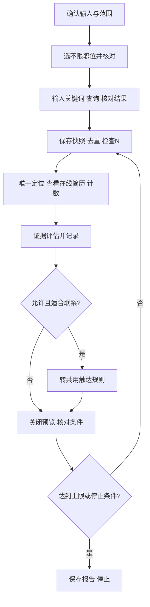

# 搜索 SOP

前置读取：[共用规则](common-rules.md)、[账本](ledger-and-recovery.md)。输入：JD、评估标准、可选否决项、关键词、N、动作范围；允许触达时还需门槛和话术。

1. 保存本轮配置、已有进度和排除名单。正式业务启动岗位账本并核对恢复；仅查看验收只建运行记录。
2. 进入 `/web/chat/search`。`search` 不带关键词可进入页面并读取，但空结果不能证明列表耗尽。
3. **先选“不限职位”，核对已生效，再填关键词并查询。** 这是页面实际文案，对应 SOP 的“不限岗位”；与后续沟通的目标 JD 岗位不同。CLI 没有设置该筛选的参数，默认由使用者在页面设置；Agent 不得自写 DOM 脚本或换浏览器工具。仅当用户按[工具使用边界](tool-boundary.md)明确授权其他方法及此筛选动作时才可例外，否则暂停该步骤并报告能力缺口。
4. 执行 `node .\dist\cli\index.js search '关键词' --json`。核对实际关键词、岗位和新结果已加载，不能仅因命令成功就宣称条件正确。当前关键词等待实现存在缺陷，固定延迟不能保证结果新鲜；未能证明条件及结果对应时停止。
5. 保存当前卡片快照；逐人做身份去重。姓名不唯一时当前 preview 不可靠，停止该人操作，不用包含匹配猜测。
6. 唯一定位且预算允许时 `preview '姓名' --json`；保存截图，核对身份、内容与完整性，观察数加1，按证据评估。条件不足记待确认；不合适只记本轮忽略，不点“不合适”。
7. 仅查看模式保存结论后继续；允许联系时按共用触达规则处理，当前搜索联系入口缺口不得掩盖。关闭预览后核对原关键词及筛选仍在。
8. 当前加载卡片处理完且未达 N，才根据页面明确的“点击加载更多”追加，不重新搜索。CLI 未封装加载更多，默认由用户执行；Agent 仅在用户明确授权其他方法及加载动作后才能按限定范围执行，不能把搜索任务本身当作许可。否则停止并报告当前观察数和能力缺口。保存新快照并按身份去重，不能复用旧序号。
9. 按共用停止条件保存进度和报告；不要为测试额度限制耗尽额度。

2026-10-14 实测：不限职位＋测试关键词可读取15张卡片，单人预览后条件保持，加载更多后30张。早期岗位变化由用户手动纠正，**不是已证实的平台不稳定**。姓名重复确实存在。只验证了一个完整截图样本；未验证额度耗尽、全列表耗尽、自动上限及恢复。

