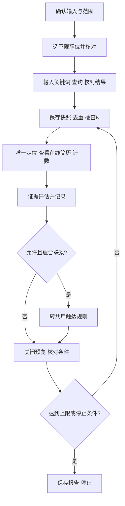

# 搜索 SOP

前置读取：[共用规则](common-rules.md)、[账本](ledger-and-recovery.md)。输入：JD、评估标准、可选否决项、关键词、N、动作范围；允许触达时还需门槛和话术。

1. 保存本轮配置、已有进度和排除名单。正式业务启动岗位账本并核对恢复；仅查看验收只建运行记录。
2. 进入 `/web/chat/search`。`search` 不带关键词可进入页面并读取，但空结果不能证明列表耗尽。
3. **先选“不限职位”，核对已生效，再填关键词并查询。** 这是页面实际文案，对应 SOP 的“不限岗位”；与后续沟通的目标 JD 岗位不同。CLI 没有设置该筛选的参数，默认由使用者在页面设置；Agent 不得自写 DOM 脚本或换浏览器工具。仅当用户按[工具使用边界](tool-boundary.md)明确授权其他方法及此筛选动作时才可例外，否则暂停该步骤并报告能力缺口。
4. 执行 `node .\dist\cli\index.js search '关键词' --json`。核对实际关键词、岗位和新结果已加载，不能仅因命令成功就宣称条件正确。当前关键词等待实现存在缺陷，固定延迟不能保证结果新鲜；未能证明条件及结果对应时停止。
5. 保存当前卡片快照；逐人做身份去重。姓名不唯一时当前 preview 不可靠，停止该人操作，不用包含匹配猜测。
6. 唯一定位且预算允许时 `preview '姓名' --json`；保存截图，核对身份、内容与完整性，观察数加1，按证据评估。条件不足记待确认；不合适只记本轮忽略，不点“不合适”。
7. 仅查看模式保存结论后继续；允许联系时按共用触达规则处理，新版CLI先以 greet "完整显示姓名" --check --json 预检，再按单步联系授权执行一次不带 --check 的命令；旧安装不支持或预检失败则停止。点击后结果不明确不重试，见共用规则。关闭预览后核对原关键词及筛选仍在。
8. 当前加载卡片处理完且未达 N，才根据页面明确的“点击加载更多”追加，不重新搜索。CLI 未封装加载更多，默认由用户执行；Agent 仅在用户明确授权其他方法及加载动作后才能按限定范围执行，不能把搜索任务本身当作许可。否则停止并报告当前观察数和能力缺口。保存新快照并按身份去重，不能复用旧序号。
9. 按共用停止条件保存进度和报告；不要为测试额度限制耗尽额度。

2026-10-14 实测：不限职位＋测试关键词可读取15张卡片，单人预览后条件保持，加载更多后30张。早期岗位变化由用户手动纠正，**不是已证实的平台不稳定**。姓名重复确实存在。只验证了一个完整截图样本；未验证额度耗尽、全列表耗尽、自动上限及恢复。

## 保持在线简历展开（本地新增）

需要逐步核验并在简历内联系时，使用 `preview "完整显示姓名" --open-only --json`。该入口仅在搜索页生效，等待 Canvas 就绪并按候选人 ID 核对；返回 `open` 后保持展开，不截图、不关闭、不沟通。同一人已打开时复用，其他人或身份不明确时报错，不自动重开。`controls` 只是诊断读数，不等于可点击或联系成功。随后按步骤执行 `greet "完整显示姓名" --check --json`，取得本步确认后才去掉 `--check`。普通 preview 会自动截图并关闭，不能用它代替这个保持展开步骤。

### Canvas 简历身份核验（2026-10-20）

搜索列表完整显示姓名必须唯一，卡片组件姓名必须一致且提供候选人 `encryptGeekId`。在线简历打开时，CLI 在主页面对应简历右侧操作区定位按钮，同时核对该组件 `geekInfo`、`resumeInfo` 的 ID 与卡片 ID 一致；不要求 Canvas 简历提供姓名 DOM。任一字段缺失、不一致或作用域不唯一直接停止，不以截图姓名或全局按钮代替身份校验。`preview --open-only` 也使用此规则。

真实只读预检已验证 `identityVerified=true`、`status=ready`、`clicked=false`；真实首次点击已弹出联系岗位选择框，后续弹层确认已验证成功，见下文。用户要求只读时必须保留 `--check`，不得因为 ready 自动联系。

## 联系弹层选岗规则

用户已明确指定本轮招聘目标岗位时，直接选择弹层中的对应岗位；未指定时先向用户确认，不采用默认选中项，也不将搜索条件“不限职位”当作联系岗位。简称须先核对唯一完整名称，歧义时询问用户。

使用 `boss greet "完整显示姓名" --select-job "联系岗位完整名称" --json`；可加 `--check` 只读核对。CLI 核对候选人 ID、精确匹配岗位并验证选中状态；该步骤只选岗，不点击弹层“立即沟通”。后续确认遵循用户当前授权范围。

确认联系使用 `boss greet "完整显示姓名" --select-job "已选岗位完整名称" --confirm-contact --json`，可先加 `--check` 只读核对。要求候选人身份与已选岗位一致，不自动改选，只点击弹层确认一次。弹层关闭且同一候选人的按钮变为“继续沟通”后返回 `contact-confirmed`、`contactConfirmed=true`；失败不得重试。仅在用户已授权联系时执行，消息3及入账仍为独立步骤。

2026-10-20 实测：n** / 大模型推理加速专家已完成弹层确认，CLI 返回 `contactConfirmed=true`。本次未单独发送消息3或写入账本。

已联系后打开会话：`boss greet "姓名" --continue-chat --candidate-id "成功回执中的候选人ID" --json`。要求当前简历仍打开，核对该 ID 的两处组件数据；不依赖联系后可能移除候选人的搜索列表。可加 `--check` 只读核对。`continue-clicked` 只确认点击，不证明已打开独立沟通页。

已知边界：2026-10-20 实测“继续沟通”打开了搜索页内聊天窗口，姓名可能由掩码变为完整显示名。当前 `chat --check` 与 `send` 仅支持 `/web/chat/index`，尚未支持该搜索页内窗口；禁止据点击回执直接发送，需先解决该窗口的身份核验和发送支持。本轮消息未发送。
